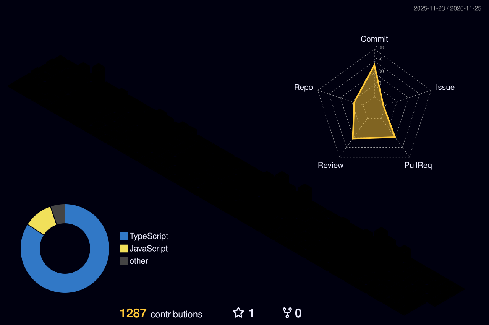

<!-- ===================== ENCABEZADO ===================== -->
<p align="center">
  
</p>

<p align="center">
  <a href="https://orlando-zarraga-portfolio.vercel.app/">
    
  </a>
</p>

<p align="center">
  <a href="https://orlando-zarraga-portfolio.vercel.app/"></a>
  <a href="https://www.linkedin.com/in/orlando-ismael-zarraga-medina"></a>
  <a href="mailto:orlandozarraga31@hotmail.com"></a>
  
</p>

<p align="center">
  📍 Argentina &nbsp;•&nbsp; 🌎 Remoto &nbsp;•&nbsp; 🟢 Disponible para nuevas oportunidades
</p>

---

## 👨‍💻 Sobre mí

Desarrollo **backends robustos y aplicaciones web completas** con Node.js, NestJS, TypeScript y React/Next.js. Me enfoco en construir **APIs REST** (Interfaz de Programación de Aplicaciones con transferencia de estado representacional) seguras, documentadas y listas para producción, con arquitecturas limpias que escalan junto al negocio.

Llevo proyectos **desde cero hasta producción**: modelado de datos, autenticación, despliegue y mantenimiento. Hoy soy el desarrollador principal de **ZarMedi**, una plataforma SaaS (Software como Servicio) en uso real por centros de salud, y desarrollador backend freelance para clientes en España.

```typescript
const orlando = {
  rol: "Backend / Full Stack Developer",
  ubicacion: "Argentina 🇦🇷 — trabajo remoto",
  backend: ["Node.js", "NestJS", "Express", "TypeScript", "PostgreSQL", "Redis"],
  frontend: ["React", "Next.js", "Tailwind CSS", "PWA"],
  arquitectura: ["DDD", "Hexagonal", "Clean Architecture", "SOLID", "Multi-tenancy"],
  cloud: ["Docker", "AWS", "CI/CD"],
  formacion: ["Henry Bootcamp (800 h)", "Codo a Codo 4.0", "Tecnicatura en Programación — UTN"],
  buscando: "Un equipo donde aportar valor desde el día uno",
};
```

---

## 🛠️ Stack tecnológico

<p align="center">
  <b>Backend</b><br/><br/>
  
</p>

<p align="center">
  <b>Frontend</b><br/><br/>
  
</p>

<p align="center">
  <b>DevOps & Herramientas</b><br/><br/>
  
</p>

<p align="center">
  
  
  
  
  
  
  
  
  
  
  
</p>

---

## 🚀 Proyectos destacados

### 🏥 ZarMedi — Software de gestión para centros de salud
Plataforma SaaS (Software como Servicio) **en producción con clientes reales**: turnos, historia clínica, teleconsulta, recetas y atención por WhatsApp.

- Backend modular con DDD (Diseño Guiado por el Dominio), multi-tenancy (varios clientes aislados en una misma plataforma) y roles.
- Frontend PWA (Aplicación Web Progresiva) responsiva y mobile-first.
- Integración de pagos online y mensajería por WhatsApp.

**Stack:** NestJS · Next.js · TypeScript · PostgreSQL · Redis · Docker

🌐 **Sitio web:** [zarmedi.com](https://zarmedi.com)

---

### 🍽️ Si Chef — Plataforma gastronómica (Full Stack)
Plataforma para el ecosistema gastronómico con backend y frontend propios.

- API REST (Interfaz de Programación de Aplicaciones) modular con NestJS.
- Autenticación con JWT (JSON Web Token), roles y permisos.
- Integración de servicios externos; frontend en React / Next.js con manejo de estado y formularios.

**Stack:** NestJS · React · Next.js · PostgreSQL · TypeORM

📂 **Repositorio:** [github.com/Orlando3486/sichef](https://github.com/Orlando3486/sichef)
🌐 **Demo:** [si-chef.vercel.app](https://si-chef.vercel.app/guest)

---

### 🛒 E-commerce API — Backend para tienda online
API REST lista para producción, desplegada en Render.

- CRUD (crear, leer, actualizar y eliminar) de productos, categorías y usuarios.
- Autenticación y autorización con JWT y manejo de roles.
- Validaciones con class-validator, seed de datos iniciales y documentación completa con Swagger.

**Stack:** NestJS · PostgreSQL · TypeORM · Swagger · JWT

📂 **Repositorio:** [github.com/Orlando3486/Ecommerce](https://github.com/Orlando3486/Ecommerce)
📄 **Swagger en vivo:** [ecommerce-ob6z.onrender.com/api](https://ecommerce-ob6z.onrender.com/api)

---

### 🏢 Intranet corporativa — Monetae
Intranet de cumplimiento normativo desarrollada durante mis prácticas.

- Backend con NestJS bajo DDD y frontend con Next.js.
- Trabajo en equipo con PR (Pull Requests), code review y flujo por ramas.

**Stack:** NestJS · Next.js · TypeScript

🔒 *Código privado de la empresa*

---

## 💼 Experiencia

<details open>
<summary><b>🏥 ZarMedi — Full Stack Developer (proyecto propio)</b> · 2026 – presente</summary>
<br/>

- Backend como monolito modular con arquitectura hexagonal y DDD, multi-tenancy y roles RBAC (control de acceso basado en roles).
- Frontend PWA responsiva y mobile-first en Next.js con TanStack Query, Zustand y Zod.
- Integración de IA generativa, bot de WhatsApp con colas asíncronas y pagos con Mercado Pago y Stripe.
</details>

<details open>
<summary><b>♾️ Infinity Software — Backend Developer (freelance, remoto, España)</b> · may 2026 – presente</summary>
<br/>

- Plataforma de gestión de ventas a crédito y cobranza para un cliente en España.
- Lideré el diseño de la arquitectura en capas y desarrollé la mayoría de los módulos: cobranza, caja y reportes.
- Autenticación JWT, aislamiento de datos multi-empresa, roles, Docker y despliegue.
</details>

<details>
<summary><b>🧪 Monetae — Full Stack Developer (prácticas, remoto, El Salvador)</b> · jul 2026 – oct 2026</summary>
<br/>

- Intranet de cumplimiento normativo desarrollada end-to-end junto al líder técnico: NestJS bajo DDD y Next.js.
- Coordiné a dos desarrolladores mediante Pull Requests y code review.
</details>

<details>
<summary><b>🌍 MMI Internacional — Full Stack Developer (prácticas part time, remoto, España)</b> · mar 2026 – jun 2026</summary>
<br/>

- Plataforma de gestión y publicación de noticias de radio y TV.
- Automaticé la validación de noticias con Python y un modelo de lenguaje local; refactoricé y rediseñé interfaces en PHP.
</details>

<details>
<summary><b>⚙️ Trama — Backend Developer (prácticas part time, remoto, Perú)</b> · mar 2026 – jun 2026</summary>
<br/>

- Software de diagnóstico de gestión para emprendedores.
- Como backend principal construí la mayoría de los módulos: autenticación completa, Google OAuth y motor de diagnóstico.
</details>

<details>
<summary><b>💻 IT Resources Innovations LLC — Full Stack Developer (contrato por proyectos, remoto)</b> · may 2023 – dic 2025</summary>
<br/>

- Sitios web responsivos, e-commerce y sistemas de turnos con JavaScript, React, Vite y Express.
- Microservicios y APIs REST con NestJS bajo Clean Architecture, JWT e integración de APIs de terceros.
- Optimización de consultas y transacciones SQL, con hasta un **30% menos** de tiempo de respuesta.
</details>

---

## 📚 Buenas prácticas que aplico

| Arquitectura | Código | Entrega |
|---|---|---|
| 🧱 Separación de responsabilidades | ✅ DTOs (Objetos de Transferencia de Datos) y validaciones | 🌱 Variables de entorno por ambiente |
| 🧩 Módulos escalables | 🛡️ Manejo centralizado de errores | 🚀 Deploy continuo en la nube |
| 🔐 Autenticación y autorización por roles | 📄 Documentación con Swagger (OpenAPI) | 🔀 Git flow y revisión de PR |

---

## 📊 Estadísticas en GitHub

<p align="center">
  
  
</p>

<p align="center">
  
</p>

<p align="center">
  
</p>

<p align="center">
  
</p>

<!-- Animación: para cambiar la viborita por Pac-Man, reemplazá "github-snake" por "pacman-contribution-graph" en las 3 rutas de abajo -->
<p align="center">
  <picture>
    <source media="(prefers-color-scheme: dark)" srcset="https://raw.githubusercontent.com/Orlando3486/Orlando3486/output/github-snake-dark.svg" />
    <source media="(prefers-color-scheme: light)" srcset="https://raw.githubusercontent.com/Orlando3486/Orlando3486/output/github-snake.svg" />
    
  </picture>
</p>

---

## 🎯 Lo que busco

Sumarme a un equipo como **Backend o Full Stack Developer** donde pueda trabajar con **Node.js / NestJS**, profundizar en arquitecturas backend y participar en productos reales en producción.

<p align="center">
  <a href="https://www.linkedin.com/in/orlando-ismael-zarraga-medina">
    
  </a>
</p>

<!-- ===================== PIE ===================== -->
<p align="center">
  
</p>
